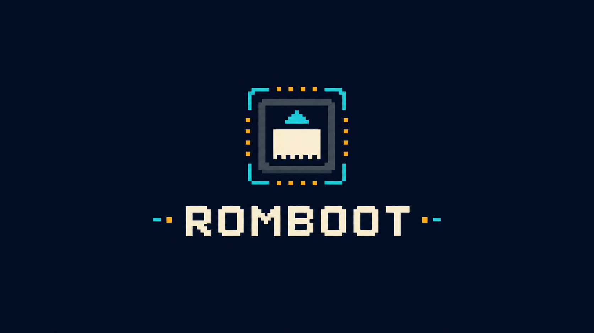

# RetroRomBoot

[](https://github.com/JoshuaGessner/RetroRomBoot/actions/workflows/ci.yml)
[](https://www.python.org/)
[](https://buildroot.org/)
[](LICENSE)

<p align="center">
  
</p>

RetroRomBoot turns one legally obtained retro-game ROM into a minimal Raspberry Pi SD-card image that boots directly to that game:

```text
power on → generic splash → game → safe shutdown
```

The generated appliance has no desktop, launcher, login prompt, package manager, or normal-operation network service. A read-only Buildroot Linux system starts a pinned RetroArch core with exactly one staged ROM. Persistent saves, when enabled, live on a small separate data partition.

> [!IMPORTANT]
> This project is currently **structurally implemented but not hardware-certified**. Host tests and Buildroot profiles exist, but a complete image and the HDMI, audio, controller, boot, shutdown, and power-loss behavior still require recorded testing on physical Raspberry Pi hardware. See [verification status](docs/verification.md).

## Why RetroRomBoot?

- **One game per card** — no game browser or general-purpose frontend.
- **Small appliance OS** — Buildroot, musl, SquashFS, and board-specific firmware profiles.
- **Simple self-hosted UI** — upload a ROM in a local Docker web app and download the image.
- **Scriptable CLI** — inspect, prepare, build, verify, and safely flash from Python.
- **Defensive input handling** — archive limits, traversal/symlink checks, hashes, manifest verification, and guarded removable-device writes.
- **Auditable inputs** — Buildroot, Linux, RetroArch, cores, container base, and package hashes are pinned.
- **No bundled games or BIOSes** — users supply only content they have the right to use.

## Quick start: Docker web UI

Docker is the recommended way to run RetroRomBoot on Linux, macOS, or Windows:

```sh
git clone https://github.com/JoshuaGessner/RetroRomBoot.git
cd RetroRomBoot
docker compose up --build
```

Open [http://localhost:8080](http://localhost:8080), upload one legally obtained ROM, choose a board and save mode, optionally supply a PNG splash, and start the build. The first build compiles the cross-toolchain, kernel, RetroArch, and cores and can take 30–60 minutes; later builds reuse a per-target cache.

The service binds to host loopback by default. It is a **single-user, self-hosted build tool**, not a public upload service. Read the [web appliance guide](docs/web-ui.md) before changing its network exposure.

Flashing is deliberately outside the web service. Download the completed image, verify its SHA-256, and use Raspberry Pi Imager, balenaEtcher, or an appropriately reviewed `dd` command.

## Command-line use

The host CLI requires Python 3.11 or newer and has no runtime Python dependencies:

```sh
python3 -m pip install -e .

# Guided terminal workflow
romboot ui

# Inspect without executing the ROM
romboot inspect /path/to/game.nes

# Show platforms and implementation status
romboot platforms

# Prepare and build with a verified Buildroot 2025.02.16 source tree
romboot build \
  --rom /path/to/game.nes \
  --platform nes \
  --target rpi4 \
  --buildroot-dir /path/to/buildroot-2025.02.16 \
  --output game.img.zst

# Verify release sidecars and compressed data
romboot verify game.img.zst

# Destructive: validates and confirms a removable whole device before writing
romboot flash game.img.zst /dev/DEVICE
```

See [building](docs/building.md), [safe flashing](docs/flashing.md), and the [interactive CLI guide](docs/interactive-ui.md) for the complete workflows.

## Current platform scope

“Structural” means the registry, pinned core, Buildroot package, and target profile exist. It does **not** mean every ROM or peripheral has been tested on real hardware.

| Platform | Core | Pi 4 | Pi Zero 2 W | BIOS |
| --- | --- | :---: | :---: | --- |
| NES / Famicom | FCEUmm | Structural | Structural | None |
| SNES / Super Famicom | Snes9x 2010 | Structural | Structural | None |
| Game Boy / Game Boy Color | Gambatte | Structural | Structural | HLE / none required |
| Game Boy Advance | mGBA | Structural | Structural | HLE / none required |
| Genesis / Mega Drive | Genesis Plus GX | Structural | Structural | None; CD systems excluded |
| Master System | Genesis Plus GX | Structural | Structural | None |
| Game Gear | Genesis Plus GX | Structural | Structural | None |
| PC Engine / TurboGrafx-16 HuCard | Beetle PCE Fast | Structural | Structural | None; CD systems excluded |
| PlayStation 1 | Registry proof only | Disabled | Disabled | Required; validation incomplete |

For limitations and the meaning of each status, see the [support matrix](docs/support-matrix.md).

## Image layout and runtime

Each generated card contains:

1. a FAT boot partition with Raspberry Pi firmware, kernel, device tree, and splash configuration;
2. a read-only XZ-compressed SquashFS root containing the minimal OS, RetroArch, selected cores, and exactly one ROM; and
3. a small ext4 data partition for saves and bounded diagnostics.

The supervisor launches the configured emulator/core directly. On emulator exit or failure it follows a bounded shutdown, single-restart, or error policy and never falls back to an unrestricted release shell. Save behavior is chosen at build time:

- `persistent` — saves survive on the data partition;
- `ephemeral` — saves live in RAM and disappear at shutdown;
- `disabled` — save output is discarded.

## Legal and security boundaries

You must supply and have permission to use every ROM, disc image, BIOS, key, firmware file, font, artwork, and custom splash. RetroRomBoot does not download, include, share, decrypt, or bypass protection for copyrighted game or console content. The default splash is project-owned and generic.

ROMs, archives, BIOSes, uploads, filenames, manifests, and device paths are treated as untrusted. Never expose the web service publicly without a strong token, TLS-capable reverse proxy, and a deliberate security review. Never flash a device until you have independently verified its path, capacity, removability, and the image checksum.

Read [BIOS and legal guidance](docs/bios-and-legal.md) and the [security policy](SECURITY.md).

## Development

```sh
make check
python3 -m build
```

CI runs the host test suite on Python 3.11 and 3.13, builds and smoke-tests the wheel, runs security-focused tests, and validates the pinned Buildroot configuration. Structural tests and QEMU cannot establish real Raspberry Pi firmware, HDMI, GPU, audio, USB, SD-card, or power-loss behavior.

Contributions are welcome. Start with [CONTRIBUTING.md](CONTRIBUTING.md), keep all downloaded sources pinned, and never commit game or BIOS content.

## Documentation

- [Docker web appliance](docs/web-ui.md)
- [Building images](docs/building.md)
- [Interactive terminal UI](docs/interactive-ui.md)
- [Platform and target support](docs/support-matrix.md)
- [Controllers, saves, and shutdown](docs/runtime-use.md)
- [Safe flashing](docs/flashing.md)
- [BIOS and legal requirements](docs/bios-and-legal.md)
- [Reproducibility and supply chain](docs/reproducibility.md)
- [Adding a platform or target](docs/extending-romboot.md)
- [Verification and hardware checklist](docs/verification.md)
- [Build-system decision record](docs/adr/001-build-system.md)

## License

RetroRomBoot's original source code is released under the [MIT License](LICENSE). Generated images also contain separately licensed components, including Buildroot, the Linux kernel, RetroArch, and libretro cores; release builds produce adjacent license information for those components.
